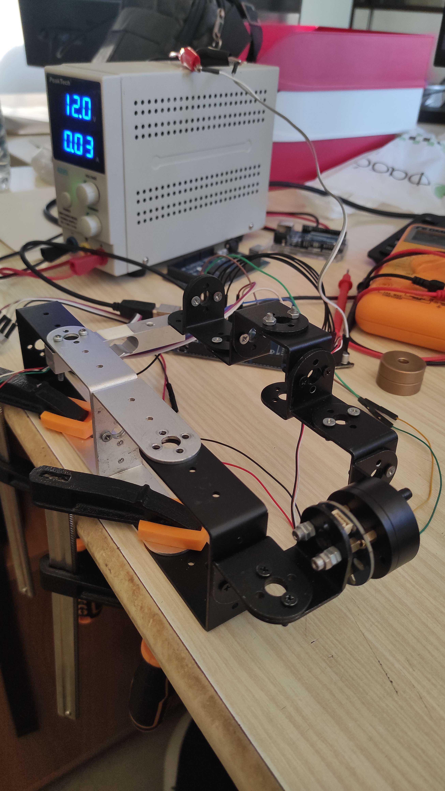
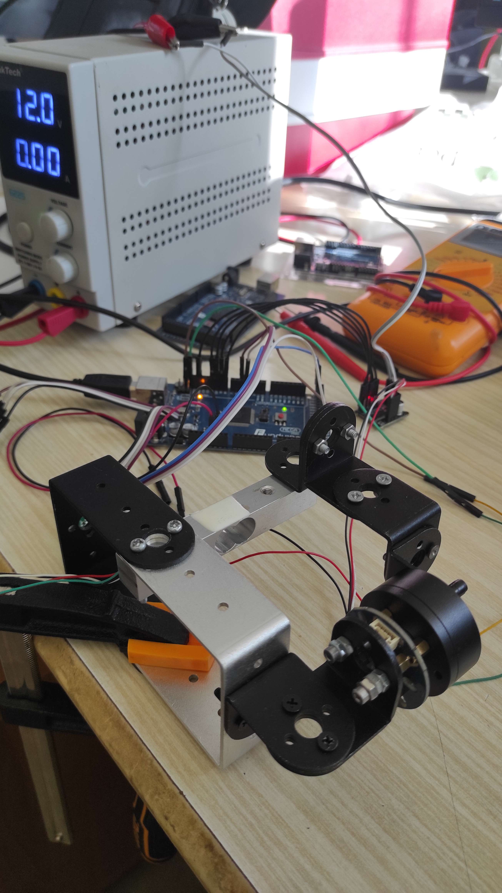
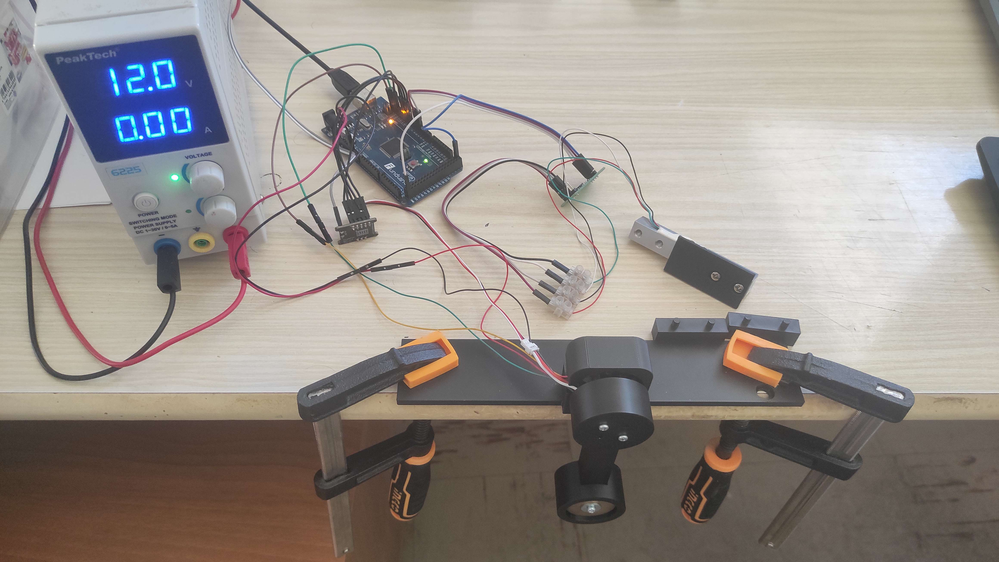
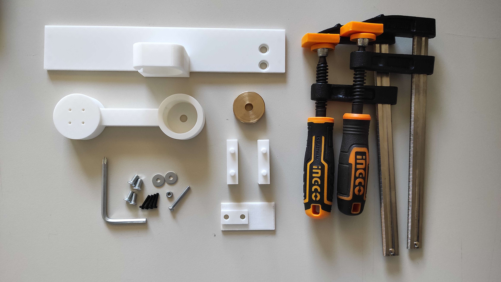
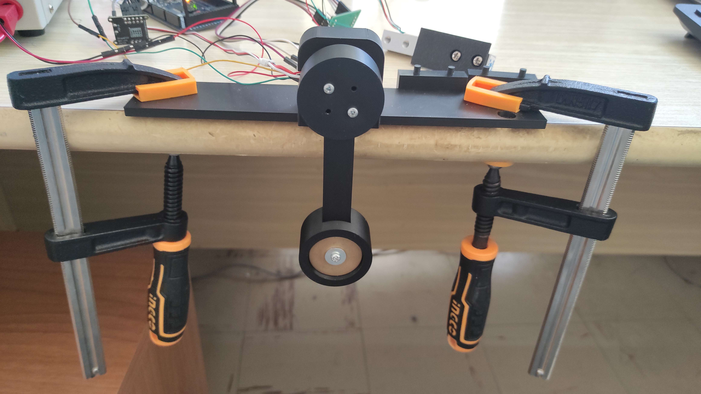
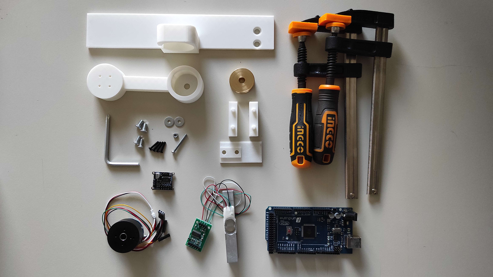

# Lab 1 — The motor-driven single pendulum

## Setup, models, and system identification

**Applied Optimal Control · Lab 1 of 4 · Groups of 3**

## Purpose

The main job of this lab is to **assemble the pendulum rig** and then verify it, so that you can estimate the physical parameters needed in Labs 2–4. The required outputs are a completed **rig card**, saved measurement data, and estimates of the motor torque constant, back-EMF constant, and pendulum friction.

By the end of the lab, you should be able to:

- assemble and wire the pendulum rig and operate it safely;

- verify the wiring and sensor/motor operation;

- calculate the pendulum inertia and gravity-torque coefficient from measurements;

- estimate the motor pole-pair count and record its alignment values;

- estimate the torque constant $k$, back-EMF constant $K_e$, mechanical viscous friction $b$, and Coulomb friction $\tau_c$;

- assemble the parameter values needed for the later controller labs.

Work through the tasks in order; the software is installed as the first task below. Do not troubleshoot powered hardware before the wiring has been checked.

## 1. Essential model and conventions

### 1.1 The pendulum is a 1-DOF robot arm, with two equilibria

Mechanically the rig is the simplest possible robot arm: one **revolute joint** (the motor shaft) and one **link** (the rod with the point mass), so it has a single degree of freedom — the joint angle $\theta$ — a **1-DOF arm**. Position and velocity of the joint are measured directly by the AS5600 encoder. Torque is the true physical input, but the SimpleFOCMini has **no current sensing**, so torque is commanded indirectly through the voltage (voltage mode, below); every controller in Labs 2–4 has to live with this "voltage → torque" imperfection.

The arm has two equilibria: **hanging, $\theta=0$**, which is **stable** (gravity pulls a nudge back, so Lab 2 only shapes the return), and **upright, $\theta=\pi$**, which is **unstable** and challenging — the error grows with time constant $\approx\sqrt{J/G}$, and the motor cannot lift the pendulum directly ($\tau_{max} \leq G$ in general), so it must swing up helped by an energy-based controller. In Labs 2–4 you select the target with `EQUILIBRIUM 1` (hanging) or `EQUILIBRIUM 2` (upright).

### 1.2 Model

The pendulum consists of a uniform rod of mass $m_r$ and length $l$, with a point mass $m_p$ at its end. Measure $l$ from the shaft axis to the centre of the point mass. With gravity $g=9.81\,\mathrm{m/s^2}$, the inertia about the shaft and the maximum gravity-torque coefficient are

$$
J=\left(\frac{m_r}{3}+m_p\right)l^2,
\qquad
G=\left(\frac{m_r}{2}+m_p\right)lg.
$$

**Mechanical model.** The applied shaft torque is $\tau$. Viscous friction opposes motion in proportion to angular velocity, and Coulomb friction opposes motion with approximately constant magnitude:

$$
\boxed{\;J\ddot\theta=\tau-b\dot\theta-\tau_c\,\operatorname{sign}(\dot\theta)-G\sin\theta\;}
$$

Here $b$ is the viscous-friction coefficient in N·m·s/rad, $\tau_c$ is the Coulomb-friction torque in N·m, and $\omega=\dot\theta$ is angular velocity in rad/s. The coefficient $G$ has units N·m, and $J$ has units kg·m².

**Nonlinear state-space model.** Define the state $\mathbf{x}=[x_1\;x_2]^\top=[\theta\;\dot\theta]^\top$ and use shaft torque $\tau$ as the input. The complete nonlinear mechanical model can be written in matrix/vector form as

$$
\boxed{\;
\dot{\mathbf{x}}=
\underbrace{\begin{bmatrix}0&1\\0&-b/J\end{bmatrix}}_{A_0}\mathbf{x}
+\underbrace{\begin{bmatrix}0\\1/J\end{bmatrix}}_{B}\tau
-\begin{bmatrix}0\\(\tau_c/J)\,\operatorname{sign}(x_2)\end{bmatrix}
-\begin{bmatrix}0\\(G/J)\sin(x_1)\end{bmatrix}
\;}
$$

**Small-angle approximation.** Near the hanging equilibrium, $\theta\approx0$ and $\sin\theta\approx\theta$. Replacing $\sin(x_1)$ by $x_1$ gives

$$
\boxed{\;
\dot{\mathbf{x}}\approx
\underbrace{\begin{bmatrix}0&1\\-G/J&-b/J\end{bmatrix}}_{A_h}\mathbf{x}
+\underbrace{\begin{bmatrix}0\\1/J\end{bmatrix}}_{B}\tau
-\begin{bmatrix}0\\(\tau_c/J)\,\operatorname{sign}(x_2)\end{bmatrix}
\;}
$$

The sine approximation is local: it is appropriate for small deviations around the hanging position, not for the full swing-up motion. The Coulomb term is still nonlinear in this approximate equation; the linear controller model omits it after feed-forward compensation, as explained later below.

**Electrical model and voltage-to-torque relation.** The SimpleFOCMini has no current sensor, so the rig commands voltage rather than measuring and controlling motor current directly. In the steady-state q-axis model, neglecting winding inductance,

$$
U_q=RI_q+K_e\omega,
\qquad
I_q=\frac{U_q-K_e\omega}{R},
\qquad
\tau=K_t I_q.
$$

$K_e\omega$ is the **back-EMF**: the voltage induced in the windings by the rotating motor. The variables and constants are:

| Symbol | Meaning | Unit |
|---|---|---|
| $U_q$ | commanded q-axis (torque-producing-axis) voltage | V |
| $I_q$ | q-axis current that produces motor torque | A |
| $R$ | motor phase resistance | $\Omega$ |
| $K_e$ | back-EMF constant | V·s/rad |
| $K_t$ | motor torque constant, $\tau=K_t I_q$ | N·m/A |
| $k$ | voltage-to-torque constant, $k=K_t/R$ | N·m/V |

With SimpleFOC's amplitude-invariant convention, $K_t=\tfrac{3}{2}K_e$, so

$$
\boxed{\;k=\frac{K_t}{R}=\frac{3K_e}{2R}\;}
\qquad
\boxed{\;\tau\approx k\left(U_q-K_e\omega\right)\;}
$$

At standstill, $\omega=0$ and $\tau\approx kU_q$. At nonzero speed, back-EMF uses part of the applied voltage and reduces the torque available at the same $U_q$. Therefore torque is not determined by voltage alone. The relation is approximate because it neglects winding inductance and other non-ideal effects, including commutation/control-loop delay, cogging, friction, and differences between rotation directions. For a star-connected motor, the phase resistance is approximately half the measured line-to-line resistance.

**Combined mechanical and electrical model.** Substituting the voltage-mode motor relation into the mechanical equation gives the plant before compensation:

$$
\boxed{
J\ddot\theta=k\left(U_q-K_e\dot\theta\right)-b\dot\theta-\tau_c\,\operatorname{sign}(\dot\theta)-G\sin\theta
}
$$

or, equivalently,

$$
J\ddot\theta=kU_q-(b+kK_e)\dot\theta-\tau_c\,\operatorname{sign}(\dot\theta)-G\sin\theta.
$$

The term $kK_e\dot\theta$ behaves like **additional electrical viscous damping**. With back-EMF compensation the controller removes it, so the design model uses $b$ alone; without compensation the effective velocity-damping coefficient would be $b+kK_e$.

**Back-EMF compensation.** If angular velocity is measured or estimated, the commanded voltage can add the estimated back-EMF term:

$$
\boxed{\;U_q=\frac{\tau_{\mathrm{des}}}{k}+K_e\omega\;}
$$

Substitution into $\tau\approx k(U_q-K_e\omega)$ gives $\tau\approx\tau_{\mathrm{des}}$, so the motor can better deliver the requested torque as speed changes. In the course setup, **all labs enable this compensation** (`USE_BACK_EMF_COMP 1`), so the linear design uses the mechanical $b$ alone.

**Coulomb-friction compensation.** The Coulomb term has no ordinary linearization at $\omega=0$: $\operatorname{sign}(\omega)$ switches sign there. The linear controller models therefore contain viscous friction $b$ but not $\tau_c$. Feed-forward compensation commands an additional torque $\tau_c\operatorname{sign}(\omega)$ so that the motor approximately supplies the torque lost to friction. Combining this with back-EMF compensation gives

$$
\boxed{\;U_q=\frac{\tau_{\mathrm{des}}+\tau_c\operatorname{sign}(\omega)}{k}+K_e\omega\;}
$$

With accurate parameters, the two compensations approximately cancel the speed-dependent back-EMF voltage drop and the direction-dependent Coulomb-friction torque. The course sketches enable both compensations by default in all labs (`USE_BACK_EMF_COMP 1`, `USE_COULOMB_COMP 1`); they can be switched off (`0`) to observe the uncompensated behaviour. Compensation is approximate, particularly when the velocity estimate is noisy or the friction estimate is inaccurate.

**The two local linearizations and their poles.** Once Coulomb friction is compensated, the small-signal linear models are $\dot{\mathbf z}=A\mathbf z+B\tau$, with $B=[0\;1/J]^\top$ in both cases. A pole is an eigenvalue of $A$ and describes a mode's exponential growth or decay.

| Equilibrium | Local state | Matrix $A$ | Poles | Meaning |
|---|---|---|---|---|
| Hanging, $\theta=0$ | $\mathbf z=[\theta\;\dot\theta]^\top$ | $A_h=\begin{bmatrix}0&1\\-G/J&-b/J\end{bmatrix}$ | $p_{h,1,2}=\dfrac{-b/J\pm\sqrt{(b/J)^2-4G/J}}{2}$ | Stable for $b>0$: both poles have negative real part. With light damping they form a complex pair and the pendulum oscillates. The undamped natural frequency is $\omega_0=\sqrt{G/J}$. |
| Upright, $\theta=\pi$ | $\mathbf z=[\varphi\;\dot\varphi]^\top$, $\varphi=\theta-\pi$ | $A_u=\begin{bmatrix}0&1\\G/J&-b/J\end{bmatrix}$ | $p_{u,1,2}=\dfrac{-b/J\pm\sqrt{(b/J)^2+4G/J}}{2}$ | Unstable: one pole is positive and one negative, so a small angle error has a growing mode. For light damping, the positive pole is approximately $+\sqrt{G/J}$. |

At the hanging equilibrium, the gravitational torque contributes $-G\theta$; at the upright equilibrium, with $\varphi=\theta-\pi$, it contributes $+G\varphi$. The upright model is therefore unstable and needs active feedback.

**Signs:** $\theta=0$ is hanging down and $\theta=\pi$ is upright. Positive angle, speed, torque, and voltage follow the same direction. Record angles in radians, masses in kilograms, length in metres, torque in N·m, voltage in volts, current in amperes, resistance in ohms, and time in seconds.

### 1.3 Field-oriented control (FOC) in brief

The BLDC motor is driven with **field-oriented control**: the three-phase voltages are chosen so the stator field stays $90^\circ$ (electrical) ahead of the rotor field, which makes a spinning BLDC behave like a simple DC motor with one controllable "quadrature" voltage $U_q$. SimpleFOC computes the required three phase voltages from $U_q$ and the **electrical angle** $\theta_e=N_{pp}\theta_m+\theta_{e,0}$, which needs the pole pairs $N_{pp}$, the measured mechanical angle $\theta_m$, and the zero electrical angle $\theta_{e,0}$ (found once by an **alignment** at power-up). You never write FOC code: the course library `FOC_lar` wraps SimpleFOC and runs `foc.update()` for you. In this lab you only find $N_{pp}$, record the alignment values, and command $U_q$ — the same FOC loop then runs underneath every controller in Labs 2–4.

## 2. Wiring and safety — instructor sign-off required

### Task 2.1 — install the software

Install the software first, before the hardware tests.

1. Install the Arduino IDE 2.x and the board package for your board.

2. Library Manager: install **SimpleFOC** (use the course-recommended version, normally 2.4.0) and **HX711_ADC**.

3. Copy the four folders `AS5600_lar`, `FOC_lar`, `LoadCell_lar`, and `Pendulum_lar` from `lab_code/libs/` into your Arduino libraries folder; restart the IDE.

4. Install the Python 3 packages `numpy`, `matplotlib`, and `pyserial`.

5. Compile (Verify only; do not upload yet) `sketches/AS5600_read` and `sketches/motor_AS5600`.

### Task 2.2 — assemble the pendulum (your main task today)

<table>
  <tr>
    <td width="40%">
      <table>
        <tr>
          <td width="20%">
            
          </td>
          <td width="20%">
            
          </td>
        </tr>
        <tr>
          <td colspan="2" align="center">
            <em>First prototypes</em>
          </td>
        </tr>
      </table>
    </td>
    <td width="60%" align="center">
      
      <em>Final full assembly</em>
    </td>
  </tr>
</table>

The pendulum is a 1-DOF robot arm: a motor (joint), a hub, a rod and a point mass (link), plus the AS5600 angle sensor. Assemble it mechanically first, then make the electrical connections. Weigh the rod, the point mass and any hardware **before** you assemble — they are hard to weigh afterwards.

**Assembly and measurement components**

| Component | Role | Relevant details / checks |
|---|---|---|
| Arduino Mega 2560 | Runs the sketches and controller, reads the angle sensor, and exchanges data with the PC | Motor-driver signals: pins 11, 10, 9 to IN1, IN2, IN3; pin 8 to EN. I²C uses SDA pin 20 and SCL pin 21. The three driver-input pins must provide hardware PWM. |
| SimpleFOCMini v1.0 motor-driver board (DRV8313) | Converts the three PWM/logic signals into three motor-phase outputs | Motor supply is 8–24 V; use 12 V for this lab, with the bench supply limited to 1 A. The board has no current sensing. Its 3.3 V LDO is limited to 10 mA. |
| Three-phase BLDC/gimbal motor | Actuator at the pendulum joint | Three phase wires; the expected pole-pair count is 7, but measure it in Task 2.5. |
| Motor base/stand and fasteners | Holds the motor stator securely | The motor body must not move while the pendulum swings. |
| Hub/coupling and shaft fastener | Connects the motor shaft to the pendulum rod | Tighten securely; slipping invalidates the measurements. |
| Pendulum rod | Link rotating about the motor shaft | Measure and record its mass $m_r$ and length; the model assumes a uniform rod. |
| Point mass and its fastener | Provides the end mass $m_p$ | Fix it securely and measure $l$ from the shaft axis to the point-mass centre. Weigh hardware included in the moving assembly if its mass is not negligible. |
| AS5600 magnetic encoder breakout | Measures the shaft's absolute angle over I²C | 12-bit measurement (4096 counts/revolution), address `0x36`. Confirm the breakout's allowed supply voltage before wiring it. |
| Diametrically magnetized disc magnet and holder | Provides the magnetic field read by the AS5600 | Centre it on the shaft axis, face the sensor towards it, and maintain a suitable constant air gap. |
| Jumper wires, motor-phase wires, supply leads and USB cable | Make the electrical connections and connect the Mega to the PC | Trace each connection rather than relying on wire colours; all logic grounds must be common. |
| 12 V DC bench supply | Powers the motor driver independently of Arduino USB | Set the current limit to 1 A and verify polarity before switching on. |
| PC with Arduino IDE and Python 3 | Uploads sketches, captures serial data, and runs the fit scripts | Use 115200 baud and close the Arduino Serial Monitor before a Python script opens the same serial port. |
| Load cell and HX711 amplifier | Measure force for the torque-constant experiment | Temporary measurement fixture; tare and calibrate with a known mass. |
| Stiff lever arm for the load cell | Converts motor torque into a force at the load cell | Keep it perpendicular to the shaft and measure the shaft-axis-to-contact distance $l_{\mathrm{arm}}$. |
| Ruler, scale and multimeter | Measure geometry/masses and check electrical resistance/continuity | Record masses in kg, lengths in m, and motor line-to-line resistance in Ω. |

**A. Mechanical assembly**


**Mechanical-only parts**


**Mechanical-only assembly**

***Leave the rod off for the sensor and motor bring-up (tasks 2.4–2.5), and for the velocity back-EMF calibration (task 2.8). Reattach it for the torque calibration, where you also need to attach the load cell and the HX711 (tasks 2.6-2.7), and for the ring-down friction model identification (task 2.9).***

**B. Electrical connections.** The wiring below is fixed, and you should follow it exactly. Do not rely on wire colours — trace each connection. The magnetic sensor AS5600 connects directly to the Arduino, not through the Mini.


**Mechanical and electrical/electronic parts**


**Full assembly**

### Wiring table

| From | To | Check |
|---|---|---|
| Arduino pin 11 | SimpleFOCMini `IN1` | PWM phase A |
| Arduino pin 10 | SimpleFOCMini `IN2` | PWM phase B |
| Arduino pin 9 | SimpleFOCMini `IN3` | PWM phase C |
| Arduino pin 8 | SimpleFOCMini `EN` | Driver enable; active high |
| Arduino GND | Mini `GND` | **Common ground is mandatory** |
| 12 V supply +/− | Mini supply terminals | Separate from Arduino USB; current limit **1 A** |
| Mini phase outputs | Three motor wires | Firm connections; order is not important for alignment |
| Arduino 5 V | AS5600 `VCC` | Check the breakout's required voltage first |
| Arduino GND | AS5600 `GND` | Ground connection |
| Arduino SDA/SCL | AS5600 SDA/SCL | Sensor connects directly to Arduino, not through the Mini |
| Arduino 5 V | HX711 `VCC` | Check the breakout's allowed supply voltage first (some are 3.3 V) |
| Arduino GND | HX711 `GND` | Ground connection |
| Arduino pin 4 | HX711 `DOUT` (or `DT`) | Data from the amplifier; matches `HX711_DOUT_PIN` |
| Arduino pin 5 | HX711 `SCK` (or `CLK`) | Clock to the amplifier; matches `HX711_SCK_PIN` |
| Load cell `E+` | HX711 `E+` | Excitation; trace the wires, do not rely on colours |
| Load cell `E−` | HX711 `E−` | Excitation return |
| Load cell `A+` | HX711 `A+` | Bridge signal; swapping `A+`/`A−` reverses the sign |
| Load cell `A−` | HX711 `A−` | Bridge signal |

The HX711 is only needed for the load-cell calibration and the torque-constant experiment (tasks 2.6–2.7); it can stay disconnected otherwise. Load-cell wire colours vary between cells—trace the markings or use the datasheet rather than assuming red/black/green/white.

The SimpleFOCMini v1.0 header is printed `GND, IN1, IN2, IN3, EN`. The sketches assume pins 11, 10, and 9 are hardware-PWM pins; confirm this for your board with the instructor. Do not rely on wire colours—trace each connection.

### Pre-power checklist

- [ ] Supply is switched off and set to **12 V with a 1 A current limit**.

- [ ] Common ground and all PWM/enable connections are correct.

- [ ] Motor wires and sensor wires are secure and correctly connected.

- [ ] AS5600 magnet is centred; the sensor faces a diametrically magnetized magnet with a suitable, constant air gap.

- [ ] **Pendulum rod is removed** for sensor/pole-pair/motor bring-up and free-spin tests.

- [ ] Instructor has checked and approved the wiring before motor power is applied.

- [ ] Measure and record motor line-to-line resistances if time permits: $R_{AB}=$ **___ Ω, $R_{BC}=$ ___ Ω, $R_{CA}=$ ___ Ω.**

**Safety rules:** Keep fingers, hair, and cables away from the shaft. Never leave a stalled motor energized unattended; it heats quickly. Use the sketch's voltage limits and the 1 A supply current limit. Remove the pendulum rod for free-spin tests. During ring-down, the driver must be disabled so that the windings do not electrically brake the motor.

### Task 2.3 — measure the pendulum

Weigh the rod and point mass separately. Measure $l$ from the shaft axis to the point-mass centre. The formulas assume a uniform rod; note any non-uniform features or hubs.

| Quantity | Value | Unit |
|---|---:|---|
| Rod mass $m_r$ |  | kg |
| Point mass $m_p$ |  | kg |
| Length $l$ |  | m |
| Inertia $J$ |  | kg·m² |
| Gravity-torque coefficient $G$ |  | N·m |
| $\sqrt{G/J}$ |  | rad/s |
| Predicted small-oscillation period $T=2\pi\sqrt{J/G}$ |  | s |

### Task 2.4 — AS5600 check

1. Upload `sketches/AS5600_read` and open the Serial Monitor at 115200 baud.

2. Confirm the sketch reports **Magnet detected**, with no too-weak/too-strong warning.

3. Rotate the shaft slowly through a full turn in both directions. Confirm the raw count wraps while the continuous position changes without a discontinuity, and verify the direction sign.

4. If the sensor fails or the angle jumps, stop and check the wiring, magnet centring, air gap, and shaft play before continuing.

### Task 2.5 — pole pairs and alignment

1. Remove all attachments from the shaft and upload `sketches/find_pole_pairs_number`.

2. Record the estimated pole-pair count; it should be close to an integer. If instructed, increase `FOC_ESTIMATE_VOLTAGE` to 1.5–2 V.

3. Set `MOTOR_POLE_PAIRS` in `sketches/motor_AS5600` to the measured value and upload it.

4. Record the printed `STORED_ZERO_ELECTRIC_ANGLE` and `STORED_SENSOR_DIRECTION` on the rig card. These values remain valid only while the motor wiring, magnet, sensor position, and pole-pair setting remain unchanged.

5. Use a small command (for example, ±1 V) to confirm that positive voltage produces positive position change. Keep the pendulum rod off the shaft. Do not exceed the sketch's voltage limit.

If the motor vibrates, moves in an unexpected direction, or runs very weakly, stop and ask the instructor to check the pole pairs, alignment, and phase connections.

### Task 2.6 — calibrate the load cell

1. Mount the load cell and connect the HX711. Upload `sketches/loadcell_calib_read`; keep the lever free during startup while the sketch tares.

2. Send `r` for the guided calibration. Use a known mass (about 50–100 g), enter its mass in grams, and send `s` to save the calibration factor.

3. Check the calibration using a **different** known mass. Wait about 2 seconds after changing the load before reading the value.

4. If the readings drift or are implausible, check the tare, calibration factor, cable contact, and mechanical preload.

### Task 2.7 — torque constant $k$

**Setup.** Attach a light, stiff lever perpendicular to the shaft so its end pushes **vertically** onto the load cell. Measure the distance from the shaft axis to the contact point and enter it as `ROD_LENGTH_M` in `torque_calibration`. Paste in the saved alignment values and set `VOLTAGE_SIGN` so the lever pushes onto the load cell. Keep `MOTOR_VOLTAGE_LIMIT` at **4 V** for this measurement and the supply current limit at **1 A**.

**Procedure.**

1. Upload `sketches/torque_calibration` and close the Arduino Serial Monitor.

2. Run:

   ```bash

   python tools/torque_fit.py --port /dev/ttyUSB0 --out torque1.csv

   # Windows example: --port COM3

   ```

3. When `#READY` appears, position the lever against the load cell **without preload** and press Enter. The sketch tares at 0 V and runs the voltage sweep.

4. Repeat once, saving the second run as `torque2.csv`. Let the motor cool between runs. Do not leave it stalled or energized unattended.

5. If measurement fails, use `data/torque_data_example.csv` to practise the fitting workflow, but label it as example data—not your measurement.

Record the fitted $k$ for each run and the mean. Note any large disagreement. The offset $b_0$ is a fit offset, not the mechanical viscous friction $b$.

**Equations and fit model.** If the load cell measures a perpendicular force $F_i$ at lever arm $l_{\mathrm{arm}}$, the torque sample is

$$
\tau_i=F_i l_{\mathrm{arm}},\qquad V_i=|U_{q,i}|.
$$

`torque_fit.py` fits both a straight line with an offset and a line constrained through the origin:

$$
\tau_i=kV_i+b_0,\qquad \tau_i=k_0V_i.
$$

For the fit with an offset, the least-squares slope and intercept are

$$
k=\frac{\sum_i(V_i-\bar V)(\tau_i-\bar\tau)}{\sum_i(V_i-\bar V)^2},
\qquad b_0=\bar\tau-k\bar V.
$$

For the fit through the origin,

$$
k_0=\frac{\sum_i V_i\tau_i}{\sum_i V_i^2}.
$$

Use the slope $k$ from the fit with an offset for `foc.setTorqueConstant(...)`; compare it with $k_0$ to see how much the offset influences the result. A nonzero $b_0$ can indicate friction/cogging, load-cell tare error, or preload. Treat the fitted relation as valid over the measured voltage range rather than extrapolating it without care.

### Task 2.8 — back-EMF constant $K_e$

**Remove the lever and pendulum rod. The shaft must spin freely.**

1. Upload `sketches/velocity_calibration`. The sketch sweeps voltage in positive and negative directions and records steady speed.

2. Run:

   ```bash

   python tools/velocity_fit.py --port /dev/ttyUSB0 --out speed.csv --torque-const <your_k>

   # Windows example: --port COM3

   ```

3. Record the low-speed $K_e$ estimates for both directions. Also record the value you choose for the rig card; note any substantial directional difference. Prefer the **low-speed** estimate.

4. If the run fails, `data/velocity_data_example.csv` can be used to test the fitting script. Mark it clearly as example data.

**Equations and fit models.** For each voltage direction, the script uses absolute values of the applied voltage and measured steady speed, $V=|U_q|$ and $w=|\omega|$, and excludes samples that fall in the no-motion/dead-zone region. By default, the straight-line fit uses moving samples up to 30 rad/s; the quadratic fit uses all moving samples.

The low-speed linear fit is

$$
w=aV+b_v.
$$

Its slope estimates the voltage-to-speed gain, so the back-EMF constant is estimated from the inverse slope:

$$
K_e=\frac{1}{a},\qquad V_f=-\frac{b_v}{a},
\qquad\text{or equivalently}\qquad V\approx K_e|\omega|+V_f.
$$

Here $V_f$ is an empirical friction/cogging/dead-zone voltage, not the back-EMF constant. The fit is performed separately for positive and negative commands so directional asymmetry can be checked.

Over the full moving-speed range, the script also fits a quadratic:

$$
w=c_0+c_1V+c_2V^2.
$$

The coefficient $c_2$ describes curvature and is tested against its fit uncertainty. To estimate the low-speed slope from this curve, let $V_0$ be the fitted zero-speed crossing if one lies in the fitted interval; otherwise use the lowest fitted voltage. Then

$$
a_0=\left.\frac{dw}{dV}\right|_{V_0}=c_1+2c_2V_0,
\qquad K_{e,\mathrm{low}}=\frac{1}{a_0}.
$$

The quadratic intercept $c_0$ is a curve-fitting parameter, not a physical motor constant. The low-speed estimate is preferred for the rig card because the speed curve can bend downward at higher speeds owing to commutation and control-loop delays, winding inductance, and drag or iron losses.

If `--torque-const` is supplied, the script also computes an approximate model-based estimate of the motor phase resistance:

$$
K_t=\frac{3}{2}K_e,\qquad
k=\frac{K_t}{R},\qquad
R_{\mathrm{est}}=\frac{K_t}{k}
=\frac{3K_e}{2k},
$$

where $k$ is the fitted torque-per-commanded-voltage slope and $R_{\mathrm{est}}$ is the estimated resistance of an individual motor winding. This estimate is indirect, not a direct resistance measurement: $K_e$ is inferred from commanded voltage versus free-shaft speed, and the fitted $k$ can be affected by voltage scaling, friction, and control behavior. Treat $R_{\mathrm{est}}$ as an approximate consistency check rather than a precise measurement.

For the balanced delta-connected FIT1034, the resistance measured by a multimeter between any two motor terminals is the line-to-line resistance, $R_{LL}$. Assuming all three windings have equal resistance, the measured resistance is one winding in parallel with the other two windings in series:

$$
R_{LL}=R_\Delta\parallel(2R_\Delta)
=\frac{2}{3}R_\Delta,
$$

where $R_\Delta$ is the resistance of an individual physical delta winding. Therefore,

$$
R_\Delta=\frac{3}{2}R_{LL}.
$$

Since $R_{\mathrm{est}}$ estimates the phase resistance $R$, compare it with the measured line-to-line resistance using

$$
\boxed{R_{\mathrm{est}}\approx R_\Delta
=\frac{3}{2}R_{LL}.}
$$

This comparison is approximate because $R_{\mathrm{est}}$ is inferred from the motor's fitted torque and speed behavior rather than measured directly with a multimeter.

### Task 2.9 — friction ring-down

1. Reattach the pendulum. Set `BRAKED_MODE 0` in `sketches/pendulum_ringdown` so the driver is disabled (EN low) and the phases are floating. If the driver does not truly disable its outputs, follow the instructor's direction to disconnect the three motor wires.

2. Start the capture/fitting script for the first run:

   ```bash

   python tools/pendulum_ringdown_fit.py --port /dev/ttyUSB0 --rod-mass <m_r> --point-mass <m_p> --length <l> --out free1.csv

   ```

3. Let the pendulum hang motionless while the rest angle is established. At `#GO`, lift it to about 60–90°, hold it still for one second, then release without pushing. Do not touch it during the 30-second recording.

4. Repeat once and save as `free2.csv`.

5. Fit the saved data using the supplied fitting script. For example:

   ```bash

   python tools/pendulum_ringdown_fit.py --csv free1.csv --rod-mass <m_r> --point-mass <m_p> --length <l>

   ```

   Repeat for `free2.csv`. If your supplied script version uses different capture/fit options, check its help text or ask the instructor.

Record the viscous friction $b$ and the Coulomb friction $\tau_c$ from the **viscous + Coulomb** fit (the script prints them as `#define VISCOUS_FRICTION` and `#define COULOMB_FRICTION`). Do not use the **viscous-only** $b$ together with $\tau_c$. Use the two runs to check repeatability. If the fit fails, the synthetic file `data/ringdown_example_SYNTHETIC.csv` may be used to test the script, but **must not be reported as measured rig data**.

**Equations and fit model.** The script integrates a nonlinear pendulum model and fits it to the measured angle trace $\theta_{\mathrm{meas}}(t_i)$ by minimizing the sum of squared angle residuals:

$$
\ddot\theta=-\omega_0^2\sin(\theta-\theta_{\mathrm{off}})-c_1\dot\theta-c_0\tanh\left(\frac{\dot\theta}{\epsilon}\right).
$$

The offset $\theta_{\mathrm{off}}$ accounts for the measured equilibrium/rest-angle offset. The hyperbolic tangent is a smooth numerical approximation to the sign function near zero velocity, used in the fitted model. The fitted parameters are interpreted as

$$
\omega_0^2=\frac{G}{J},\qquad c_1=\frac{b}{J},\qquad c_0=\frac{\tau_c}{J}.
$$

Once $J$ is calculated from Task 2.3, recover the physical parameters as

$$
G_{\mathrm{fit}}=\omega_0^2J,\qquad b=c_1J,\qquad \tau_c=c_0J,
\qquad \omega_0=\sqrt{\omega_0^2},\qquad T_0=\frac{2\pi}{\omega_0}.
$$

The script compares a **viscous-only fit** (with $c_0=0$) against a **viscous-plus-Coulomb fit** (with $c_0$ fitted). Compare their RMS angle residuals: a substantial reduction when $c_0$ is included is evidence that Coulomb friction matters. Viscous damping typically makes the oscillation envelope decay approximately exponentially; Coulomb friction contributes a more nearly linear reduction in peak amplitude. Compare $G_{\mathrm{fit}}$ with $G$ from the measured masses and length as a check on the geometry and inertia assumptions. The required ring-down has the driver disabled; enabling the driver at zero voltage can short the windings and add electrical damping of approximately $kK_e$.

## 3. Complete the rig card

This card is used in Labs 2–4. Save a copy and keep it with your data.

### Final checks

Before leaving, confirm that:

- [ ] The instructor-approved wiring and motor alignment are recorded.

- [ ] The rig card is complete, with any unavailable estimate explicitly marked missing.

- [ ] Your own torque, speed, and ring-down data files are saved in a backed-up folder.
